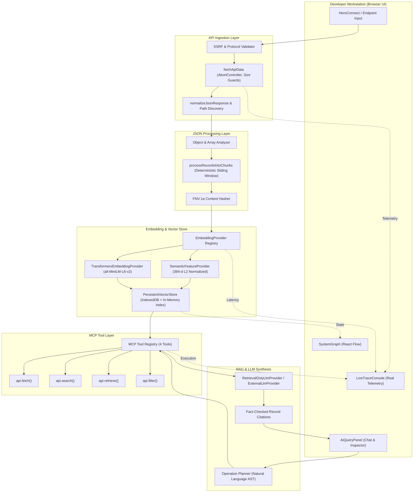

# API Neural Network — System Architecture

## 1. Overview & Core Philosophy

**API Neural Network** is an interactive developer observability platform and grounded semantic retrieval engine that transforms structured JSON REST APIs into queryable neural embeddings. 

The system rejects mock delays, simulated responses, fabricated similarity scores, and character-position pseudo-vectors in favor of deterministic, verifiable engineering:
- **Zero Simulation**: Every millisecond reported reflects actual execution time via `performance.now()`.
- **Strict Grounding**: RAG answers cite exact record IDs (`[Record #id]`) and specific field paths.
- **Real Vector Mathematics**: High-dimensional embeddings with Euclidean unit normalization and mathematical cosine similarity.
- **Genuine MCP Server**: Model Context Protocol tool dispatcher with strict schema validation.

---

## 2. Component Architecture Diagram

---

## 3. Data Flow Specification

### 3.1 Pipeline Ingestion Flow
1. **Endpoint Evaluation**: The target URL is submitted via the UI or `api.fetch()`. If `mode: 'demo'` is active, verified sample datasets (Products, Users, Transactions) are loaded without network dependencies. If `mode: 'live'` is active, `validateApiUrl()` enforces HTTP/HTTPS and blocks cloud metadata IPs (`169.254.169.254`).
2. **Payload Acquisition**: `fetchApiData()` issues a fetch with a 15-second AbortController timeout and 5 MB size limit.
3. **Telemetry & AST Normalization**: `normalizeJsonResponse()` discovers all unique dot-separated field paths, counts null values, detects nested structures, and calculates UTF-8 payload byte sizes.
4. **Deterministic Chunking**: `processRecordsIntoChunks()` breaks records into bounded RAG chunks (default 600 characters with 100 character overlap) and assigns stable FNV-1a hashes.
5. **Dense Vector Generation**: High-dimensional vectors (384 dimensions) are generated. Vectors are L2 normalized such that $\sum v_i^2 = 1.0$.
6. **Persistent Vector Indexing**: `globalVectorStore.reindexSource()` writes vectors atomically to browser IndexedDB with source namespace isolation.
7. **MCP & Query Readiness**: 4 MCP tools are bound to the active dataset and made available for natural language queries.

---

## 4. Security Architecture

1. **SSRF Guard**:
   - Forbids private IP ranges, loopback endpoints, and AWS/GCP cloud metadata IP `169.254.169.254`.
   - Restricts protocols strictly to `http:` and `https:`.
2. **Prototype Pollution Protection**:
   - `validateOperation()` blocks sensitive keys (`__proto__`, `constructor`, `prototype`, `eval`, `script`).
   - Fields evaluated by `api.filter()` must match `/^[a-zA-Z0-9_.]+$/`.
3. **Secret Isolation**:
   - External LLM API keys (Gemini, OpenAI) are kept in memory and never bundled into client assets or source control.
4. **Source Isolation**:
   - Searching or filtering vectors in the vector store requires explicit source namespaces. Vectors from API A are never leaked into API B queries.

